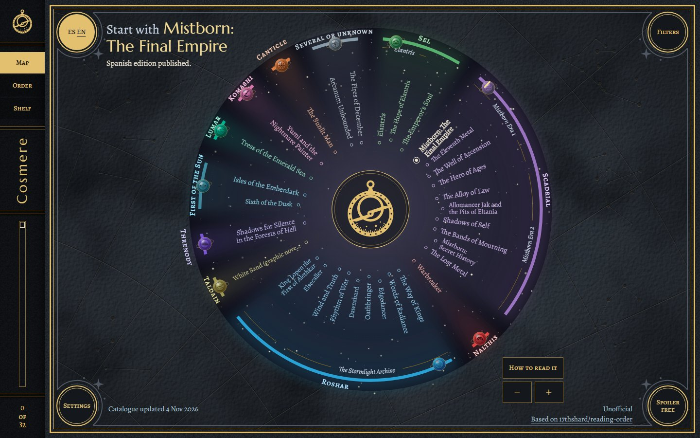
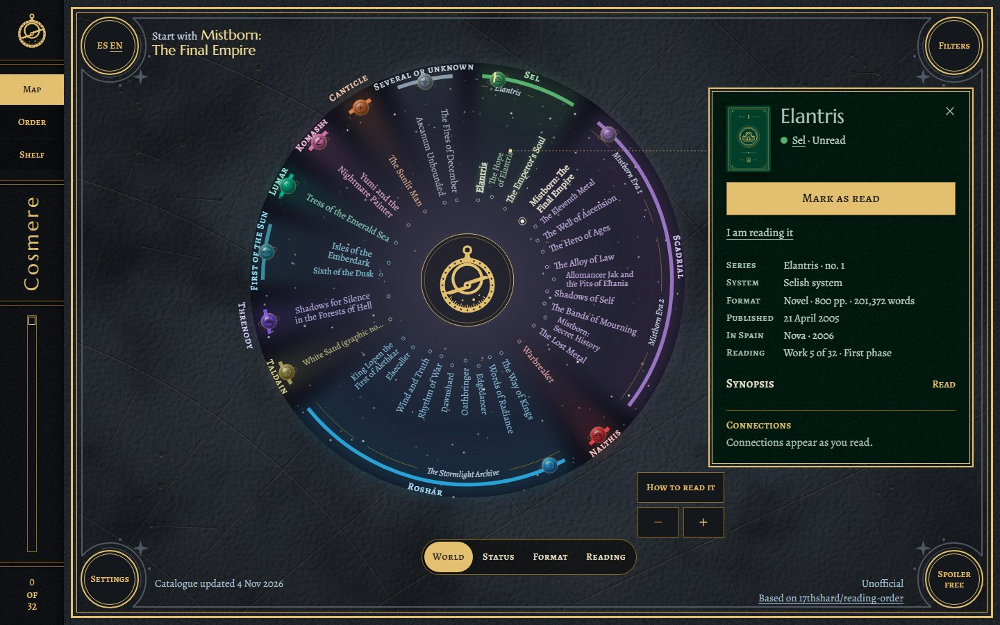
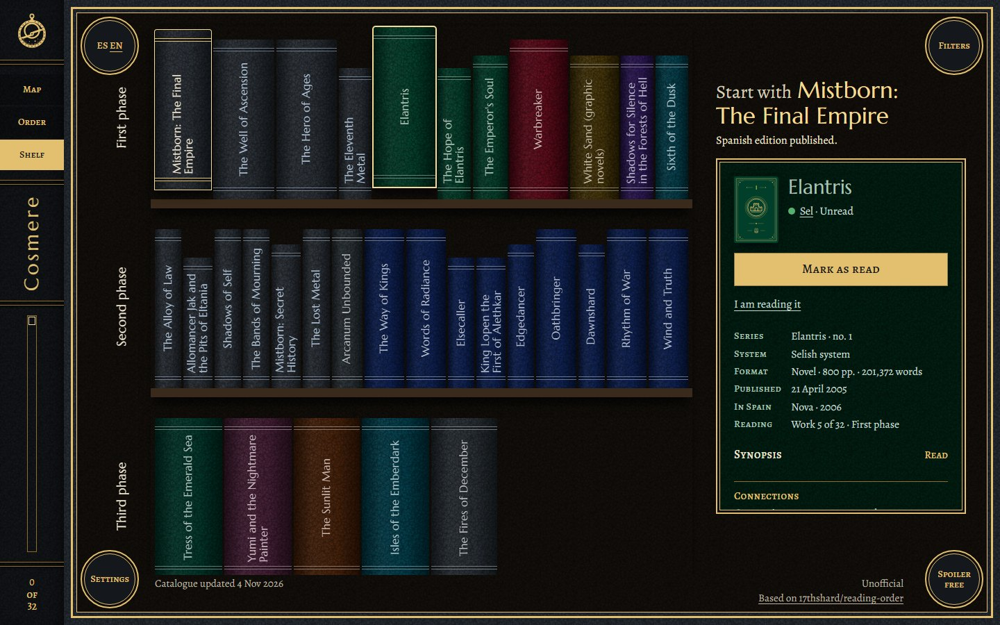
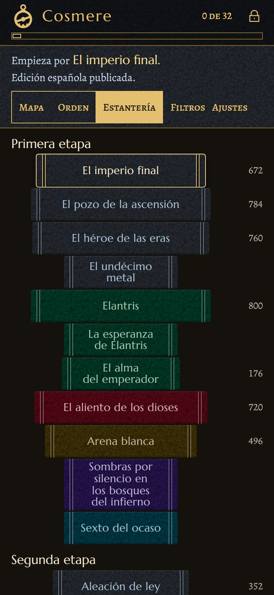

<p align="center">
  
</p>

<h1 align="center">Cosmere Reading Order</h1>

<p align="center">
  <strong>What to read next in Brandon Sanderson's Cosmere,<br>and nothing you are not ready to know.</strong>
</p>

<p align="center">
  <a href="https://github.com/alexalbella/cosmere-reading-order/actions/workflows/ci.yml"></a>
  <a href="LICENSE"></a>
  
  
  
</p>

<p align="center">
  
</p>

A website with the reading order of the Cosmere: all 105 works, from the novels to the role-playing books, in English and in the editions published in Spain. You mark what you have read, the site tells you what comes next, and whatever links one work to another stays out of sight until you have read everything it gives away.

It is a Vue 3 rewrite of [17thshard/reading-order](https://github.com/17thshard/reading-order), whose history this repository keeps.

## What it does

- A sentence at the top says which book you are on, which comes next and whether its Spanish edition is out. It follows the order you choose, recommended or by publication.
- You can look at the same catalogue three ways: as a map with the works on a ring by world, as the reading order in one line, or as a shelf of spines by phase.
- Every work has a plate with its series and number, star system, format, pages and words, first publication, Spanish publisher, and a link to read it for free when the author gives it away. Works that are announced, apocryphal or role-playing books add their own facts: how far the writing is, when it is expected, who publishes it, whether it is canon.
- Connections, synopses and notes each list the works they would spoil, and appear only when you have read them all. A synopsis stays folded until you ask for it.
- Your marks live on the device. With the full deploy they also travel between your devices; without it, you can export them to a file and import it elsewhere.
- It works offline, installs as an app, and loads with under 100 KB of JavaScript.
- The interface is in English and Spanish, and every title appears in both where both exist.
- Text contrast is at least 4.5:1, touch targets are 44 px, everything works from the keyboard, and motion stops when you ask for less.

## The spoiler promise

Nothing about a work you have not read reaches the screen.

- One function, [`src/spoilers/visible.ts`](src/spoilers/visible.ts), is the only path from the data to the screen.
- A connection is drawn only when every work in its `requires` list is read. The list holds both ends and anything else the text gives away.
- A hidden connection leaves nothing behind: there is no line, no count beside a book, no gap in the layout and no element in the page.
- An entry with a missing or broken field stays hidden.
- A synopsis waits only on earlier works of its own series, so a lock never tells you that two series are tied.
- Marking a book takes a deliberate tap on its plate, and unlocking one by hand asks first and can be undone.

[`docs/SPOILERS.md`](docs/SPOILERS.md) lists the twelve rules, each with the tests that prove it.

> [!WARNING]
> The data files are public and anyone can read them. If you are still reading the books, do not open `data/connections/`, `data/synopses/` or `data/notes/`.

## Screenshots

<table>
  <tr>
    <td width="50%"></td>
    <td width="50%"></td>
  </tr>
  <tr>
    <td>Touch a title and its plate opens beside it, while the ring moves over to make room.</td>
    <td>The shelf shows the same works as spines, in the colour of their world.</td>
  </tr>
</table>

<p align="center">
  
  <br>
  <em>On a phone, here in Spanish.</em>
</p>

## Quick start

You need Node 24 (see `.nvmrc`).

```bash
git clone https://github.com/alexalbella/cosmere-reading-order.git
cd cosmere-reading-order
npm ci
npm run dev
```

`npm run dev` validates the catalogue, builds it into `public/data/` and starts Vite.

| Command | What it does |
| --- | --- |
| `npm run dev` | Build the data and start the dev server. |
| `npm test` | Unit tests (Vitest). |
| `npm run e2e` | Browser tests (Playwright). Run `npx playwright install chromium` once. |
| `npm run lint` | ESLint. |
| `npm run build` | Type-check, build, and check the first-load budget of 100 KB gzipped. |
| `npm run validate:data` | Check the catalogue. Prints codes and ids only, never content. |

`.githooks/pre-commit` looks for secrets with gitleaks, then runs the tests and the linter. Arm it once per clone:

```bash
git config core.hooksPath .githooks
```

## Run your own copy

The build is a folder of static files. Put `dist/` on any host and marks stay on each device. For marks that follow you between devices, deploy the Worker with Cloudflare KV and Access. [`docs/DEPLOY.md`](docs/DEPLOY.md) covers both.

The catalogue is a set of JSON files you can edit by hand. [`docs/DATA.md`](docs/DATA.md) describes every file and field, and how to add a work, a connection, a synopsis or a note. The validator reports what is wrong by code and id.

## How it fits together

```
data/                 the sources: works, connections, synopses, notes, public facts
scripts/              build and validate the data, generate textures and sprites
src/
  spoilers/           visible.ts, the one gate between data and screen
  data/               types, and what makes an entry sound
  views/              the map, the reading order, the shelf
  components/         the plate, the panels, the sentence
  imagery/            emblems, icons and covers, all drawn as SVG
  state/  sync/       marks on the device, and their way to the server
worker/               the Cloudflare Worker that keeps marks in KV
tests/  e2e/          unit and browser tests, on invented fixtures
docs/                 the guides below
```

## Docs

| Guide | For |
| --- | --- |
| [`docs/DATA.md`](docs/DATA.md) | Every data file and field, editing by hand, the validator and its codes. |
| [`docs/SPOILERS.md`](docs/SPOILERS.md) | The spoiler rules as guarantees of the code, with their tests. |
| [`docs/DEPLOY.md`](docs/DEPLOY.md) | Static hosting, or Cloudflare with Access and synced marks. |
| [`docs/DESIGN.md`](docs/DESIGN.md) | Colour per world, type, motion, the pieces. |

## Where it comes from

This is a fork of [17thshard/reading-order](https://github.com/17thshard/reading-order) by Marvin Rösch and the 17th Shard, MIT licensed. The map of worlds, the reading orders, the colour per world and the idea of drawing connections come from there, and so do many of the connections themselves.

## Licence and disclaimer

The code is MIT licensed ([`LICENSE`](LICENSE)) and the fonts are under the SIL Open Font License (`public/fonts/OFL.txt`).

The seal, the emblems, the covers and the leather are all drawn for this project. The repository holds no official Dragonsteel image, cover, map or illustration, and the synopses are written for this site instead of taken from a publisher.

The Cosmere and its works belong to Dragonsteel Entertainment. This is an **unofficial fan project**, not affiliated with or endorsed by Brandon Sanderson, Dragonsteel or the 17th Shard.
